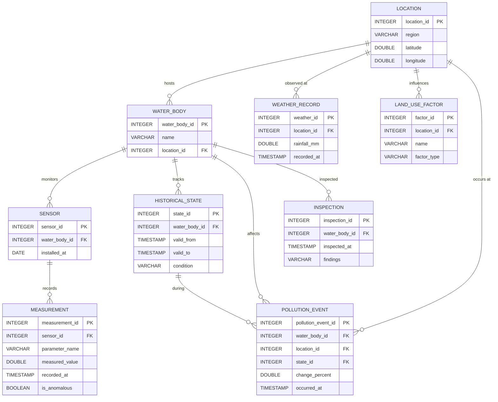

# AquaTrace — Spatiotemporal Water Body Monitoring System

> A relational database and interactive dashboard for monitoring water quality, pollution events, and environmental pressures across multiple catchment areas.

AquaTrace models a complete environmental observation pipeline: geographic locations, water bodies, sensor networks, time-series measurements, weather records, land-use pressures, historical condition states, pollution events, and field inspections. The system is backed by an embedded DuckDB analytical database and served through a lightweight Python HTTP server with a single-page dashboard.

---

## Quick Start

### Prerequisites

- Python 3.9+
- pip

### Installation

```bash
pip install -r requirements.txt
```

> [!NOTE]
> The only runtime dependency is **DuckDB**. The database file (`water_monitor.duckdb`) is created automatically on first run.

### Run the monitoring dashboard

```bash
python server.py
```

Open **http://127.0.0.1:8766** in your browser.

### Run the SQL workbench

```bash
python demo.py
```

Open **http://127.0.0.1:8765** — a focused query-execution interface.

### Run queries from the command line

```bash
python run_queries.py            # All eight analytical queries
python run_queries.py --query 1  # Single query (1–8)
python run_queries.py --step     # Step through interactively
```

### Run tests

```bash
python -m unittest test_queries.py -v
```

### Run performance benchmark

```bash
python benchmark.py              # Compares query execution with/without indexes
```

---

## Architecture

### Entity-Relationship Diagram



### Database Schema (9 tables)

| Table | Purpose |
|---|---|
| **LOCATION** | Geographic coordinates (WGS-84 latitude/longitude) and region names for each catchment area. |
| **WATER_BODY** | Named water bodies (lakes, reservoirs, wetlands) linked to their geographic location. |
| **SENSOR** | Monitoring sensors installed at water bodies, with installation dates. |
| **MEASUREMENT** | Time-series observations (Turbidity in NTU, pH) recorded by sensors, with boolean anomaly flags. |
| **WEATHER_RECORD** | Rainfall observations (mm) at locations, timestamped for temporal correlation with events. |
| **LAND_USE_FACTOR** | Environmental pressure factors (industrial, urban, agricultural) associated with each location. |
| **HISTORICAL_STATE** | Temporal state tracking with validity intervals (`valid_from` / `valid_to`). A `NULL` `valid_to` indicates a currently open state. |
| **POLLUTION_EVENT** | Recorded pollution events with percentage-change metrics, linked to water bodies, locations, and historical states. |
| **INSPECTION** | Field inspection findings recorded at water bodies with timestamps. |

### Indexes

Three composite indexes are defined to optimise the most common temporal and spatial query patterns:

| Index | Columns | Optimises |
|---|---|---|
| `weather_location_time` | `WEATHER_RECORD(location_id, recorded_at)` | Rainfall look-ups within a time window at a specific location (used by Query 1). |
| `measurement_sensor_time` | `MEASUREMENT(sensor_id, recorded_at)` | Chronological retrieval of readings from a given sensor (used by Query 2 and 3). |
| `pollution_location_time` | `POLLUTION_EVENT(location_id, occurred_at)` | Event filtering by location and date range (used by Query 5 and the dashboard). |

---

## Analytical Queries

### Query 1 — Pollution events associated with recent rainfall

Joins pollution events with weather records at the same location, filtering for events where the pollution change exceeds 30 % and rainfall was recorded within the preceding 24 hours.

- **SQL techniques**: Multi-table `JOIN`, `WHERE` with compound predicates, `INTERVAL` arithmetic
- **Expected result**: 2 rows (Eastmere Lake 45.8 %, Cedar Wetland 33.5 %)
- **Interpretation**: Co-occurrence of rainfall and a pollution spike suggests a temporal association; it does not establish rainfall as the direct cause.

### Query 2 — Sensors with multiple anomalous readings

Groups anomalous measurements by sensor and retains only sensors with more than one flagged reading, ordered by anomaly count descending.

- **SQL techniques**: `JOIN`, `WHERE` boolean filter, `GROUP BY`, `HAVING`, `COUNT`, `ORDER BY`
- **Expected result**: 2 rows (Sensor 101 with 3 anomalies, Sensor 201 with 2 anomalies)
- **Interpretation**: Repeated anomaly flags highlight sensors that may require calibration review or indicate persistent water-quality issues at their location.

### Query 3 — Average measurement for each water body

Calculates the arithmetic mean of measured values and the total reading count for each water body, grouped separately by parameter name so that different measurement units (NTU and pH) are never averaged together.

- **SQL techniques**: Two-level `JOIN` (WATER_BODY → SENSOR → MEASUREMENT), `AVG`, `COUNT`, `GROUP BY` on multiple columns, `ORDER BY`
- **Expected result**: 5 rows (4 water bodies × Turbidity + 1 water body × pH)
- **Interpretation**: Provides a baseline summary of water quality across the monitoring network; Eastmere Lake additionally reports pH readings from its second sensor.

### Query 4 — Water bodies associated with industrial land-use factors

Finds water bodies whose registered location shares an industrial land-use factor, joining through the common `location_id`.

- **SQL techniques**: `JOIN` on shared foreign key, `WHERE` equality filter, `ORDER BY`
- **Expected result**: 3 rows (Eastmere Lake linked to two industrial factors, Willow Reservoir linked to one)
- **Interpretation**: The join is based on matching location IDs. For geographic distance calculations, see Query 7.

### Query 5 — Pollution events with historical states

Links each pollution event to its historical state record, including the state's validity period and condition label, ordered by event timestamp descending.

- **SQL techniques**: `JOIN` on `state_id`, `WHERE` numeric filter, `ORDER BY DESC`
- **Expected result**: 5 rows (all recorded pollution events with their corresponding state)
- **Interpretation**: A `NULL` `valid_to` denotes a currently open historical state, meaning the condition has not yet been superseded.

### Query 6 — Year-over-year turbidity trend

Calculates annual average turbidity per water body and computes Year-over-Year (YoY) percentage change using SQL window functions.

- **SQL techniques**: Window function `LAG() OVER (PARTITION BY ... ORDER BY ...)`, `EXTRACT(YEAR ...)`, `AVG()`, `ROUND()`, `NULLIF()` to avoid division by zero
- **Expected result**: 20 rows (4 water bodies × 5 years: 2022–2026)
- **Interpretation**: Demonstrates multi-year water quality trajectory, quantifying annual degradation or recovery per catchment.

### Query 7 — Spatial proximity to industrial land use (Haversine formula)

Computes great-circle geodesic distances between water bodies and industrial land-use factors using the spherical Haversine formula on WGS-84 coordinates, filtering for facilities within 2.0 km.

- **SQL techniques**: Spherical trigonometry (`SIN`, `COS`, `RADIANS`, `ASIN`, `SQRT`, `POWER`), `CROSS JOIN`, geometric filtering (`<= 2.0 km`)
- **Expected result**: 3 rows with exact distances in kilometers
- **Interpretation**: Replaces simplistic location-ID matching with true spatial proximity analysis without requiring external GIS extensions.

### Query 8 — Statistical anomaly detection (2-sigma threshold)

Calculates dynamic baseline statistics (mean and standard deviation) for each sensor and flags time-series readings exceeding $\mu + 2\sigma$.

- **SQL techniques**: Subquery aggregation (`AVG`, `STDDEV`), statistical z-threshold evaluation, `CASE WHEN` conditional classification
- **Expected result**: 5 anomalous readings identified
- **Interpretation**: Transitions the system from static, pre-recorded boolean flags to dynamic, algorithmic anomaly detection on time-series telemetry.

---

## Dashboard Pages

The interactive dashboard (`index.html`) served by `server.py` provides four navigable pages:

### 1. Overview

The landing page presents a consolidated view of the monitoring network:
- **Summary statistics** — water body count, sensor readings, flagged anomalies, and pollution events (with filter-aware counts).
- **Catchment geography** — an SVG coordinate plot (WGS-84) with clickable site markers colour-coded by current condition (stable/recovering vs. under observation/deteriorating).
- **Water quality over time** — annual mean turbidity trend chart (NTU) with per-water-body polylines spanning 2022–2026.
- **Monitored water bodies** — a list card showing each water body's region, sensor count, and current historical state.
- **Recent pollution events** — the latest events with change-percentage badges.
- **Weather observations** — live rainfall telemetry card per monitoring location.

### 2. Sensor Network

A tabular inventory of all sensors with per-sensor statistics computed from the filtered observation window:
- Sensor ID, linked water body, parameter name, total readings, anomaly count, last observation date, and a review-status tag (`Review required` for ≥ 2 anomalies, `Single flag`, or `No repeated flags`).
- **Interactive alert threshold input** — configure a custom turbidity limit (NTU) to dynamically highlight out-of-spec sensors.
- **Click-to-sort columns** — click any column header to sort ascending or descending.
- **CSV export** — one-click download of the complete sensor dataset.
- Accompanied by the turbidity trend chart for contextual comparison.

### 3. Event History

A dual-panel view combining structured tables and a chronological timeline:
- **Pollution event register** — all events with their linked historical-state condition tag and CSV export.
- **Environmental context** — land-use factors associated with visible water body locations and CSV export.
- **Historical record timeline** — a vertical timeline merging historical state transitions and field inspection entries, sorted most-recent-first.

### 4. SQL Analysis

An interactive query execution workspace:
- Tabbed selection of all **8 analytical queries** with formatted SQL editor.
- One-click execution via the `/api/query/:id` endpoint with result count, execution time, and rendered result table.
- **Result CSV export** — download any query result set directly to CSV.
- Contextual interpretation notes displayed below each query.

> [!TIP]
> Overview filters (water body, year) apply to the first three pages but are intentionally disabled on the SQL Analysis page, where queries always run against the complete database.

---

## Project Structure

| File | Description |
|---|---|
| `01_schema.sql` | DDL statements for all 9 tables and 3 indexes. |
| `02_seed.sql` | INSERT statements with synthetic demonstration data (100 measurements, 5 events, 3 inspections, etc.). |
| `queries.sql` | All 8 analytical SQL queries (rainfall, anomalies, averages, land-use, historical states, YoY trends, spatial Haversine, 2σ detection). |
| `demo.py` | Core application logic: schema/seed loader, database setup, query execution, and embedded SQL workbench server (port 8765). |
| `server.py` | HTTP server for the monitoring dashboard (port 8766), serving `index.html` and REST JSON API endpoints. |
| `run_queries.py` | CLI tool for executing queries with formatted table output, supporting single-query and step-through modes. |
| `benchmark.py` | Performance benchmarking script comparing query execution times with and without database indexes over 50 iterations. |
| `index.html` | Single-page dashboard UI with four navigable views, SVG charts, CSV export, alert thresholding, and sortable tables. |
| `test_queries.py` | Automated test suite validating schema counts, query outputs, and server dataset integrity. |
| `requirements.txt` | Python dependency declaration (`duckdb>=0.9.0`). |
| `.gitignore` | Excludes temporary files, duckdb artifacts, and local logs from version control. |
| `water_monitor.duckdb` | Persistent DuckDB database file (auto-generated on first run). |
| `results.json` | Cached query execution results written by `demo.py`. |
| `SQL_RESULTS.txt` | Formatted ASCII table outputs of all 8 queries for quick inspection. |
| `README.md` | Comprehensive system architecture and operational documentation. |

---

## Data Provenance

All records in this system are **synthetic demonstration data**. Water body names (Eastmere Lake, Willow Reservoir, Northfield Lake, Cedar Wetland), geographic coordinates, industrial site names, and measurement values are fictional. The 100 measurement records span five years (2022–2026) with four observations per sensor per year, designed to illustrate realistic monitoring patterns including gradual value drift and occasional anomaly spikes.

Anomaly flags (`is_anomalous`) are pre-assigned in the seed data to demonstrate detection and review workflows; they are **not** computed from statistical thresholds at query time.

---

## Technical Notes

- **DuckDB** is used as an embedded analytical database — no separate database server is required. The database file is created in the project directory on first run.
- **No external dependencies** beyond `duckdb` are needed. The HTTP server uses Python's built-in `http.server` module; the dashboard is a self-contained HTML/CSS/JS page with no framework or build step.
- **Coordinate view** uses WGS-84 latitude/longitude values plotted on an SVG grid. This is a schematic coordinate plot, **not** a GIS basemap or satellite imagery layer.
- **Anomaly flags** are stored boolean values in the MEASUREMENT table, not computed in real-time. Query 2 counts these stored flags rather than applying a statistical anomaly detection algorithm.
- **Temporal intervals** in Query 1 use DuckDB's `INTERVAL '24 hours'` syntax for rainfall correlation windows.
- **Historical states** use a validity-interval pattern (`valid_from` / `valid_to`) where `NULL` in `valid_to` denotes the currently active state.

---

## Scope and Implemented Extensions

- **Query 1 Rainfall Association**: Query 1 links pollution events with weather records within a preceding 24-hour window. This demonstrates temporal association, not verified physical causation.
- **Year-over-Year Trend Analysis (Implemented in Query 6)**: While Query 3 calculates global averages, Query 6 introduces multi-year window functions (`LAG()`) to compute annual average turbidity and year-over-year percentage shifts.
- **Geographic Proximity Analysis (Implemented in Query 7)**: Query 4 performed simple relational joins on `location_id`. Query 7 computes exact geodesic distances using the spherical Haversine formula to identify industrial factors within 2 km without requiring external GIS plugins.
- **Statistical Anomaly Detection (Implemented in Query 8)**: In addition to the pre-seeded boolean flags (`is_anomalous`), Query 8 implements automated statistical anomaly detection by computing $\mu + 2\sigma$ thresholds per sensor.
- **Index Benchmarking (Implemented in `benchmark.py`)**: `benchmark.py` provides reproducible execution metrics with and without indexes across 50 iterations. On small in-memory datasets (100 rows), direct table scans are comparable; index advantages scale as time-series datasets grow.
- **Interactive Dashboard Controls**: The UI supports interactive alert threshold configuration, responsive table sorting, and client-side CSV downloads for analytical workflows.

---

## License

Academic project — for educational and demonstration purposes.
