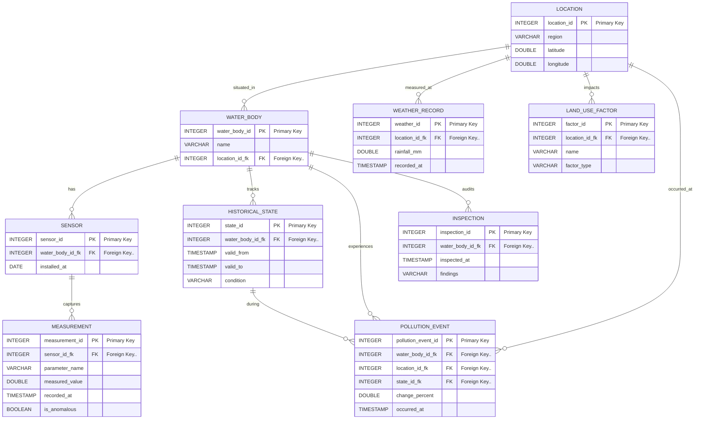

# RVCE DBMS Lab — ER Diagram & Relational Schema Guide
**Project Title:** AquaTrace — Spatiotemporal Water Body Monitoring Database System  
**Standard Academic Format:** Peter Chen ER Notation & Relational Schema Mapping

---

## 1. Relational Schema Representation (Exact Academic Notation)

> **Notation Rules (as per RVCE/VTU Lab Standards):**
> - **Primary Key (PK):** Highlighted with a solid underline: $\underline{\text{attribute}}$
> - **Foreign Key (FK):** Highlighted with dotted notation: $\text{attribute}..$ (dotted line pointing to referenced table)

1. **`LOCATION`**  
   $$\text{LOCATION}(\underline{\text{location\_id}}, \text{region}, \text{latitude}, \text{longitude})$$

2. **`WATER_BODY`**  
   $$\text{WATER\_BODY}(\underline{\text{water\_body\_id}}, \text{name}, \text{location\_id}..)$$  
   *$\text{location\_id}..$ references $\text{LOCATION}(\underline{\text{location\_id}})$*

3. **`SENSOR`**  
   $$\text{SENSOR}(\underline{\text{sensor\_id}}, \text{water\_body\_id}.., \text{installed\_at})$$  
   *$\text{water\_body\_id}..$ references $\text{WATER\_BODY}(\underline{\text{water\_body\_id}})$*

4. **`MEASUREMENT`**  
   $$\text{MEASUREMENT}(\underline{\text{measurement\_id}}, \text{sensor\_id}.., \text{parameter\_name}, \text{measured\_value}, \text{recorded\_at}, \text{is\_anomalous})$$  
   *$\text{sensor\_id}..$ references $\text{SENSOR}(\underline{\text{sensor\_id}})$*

5. **`WEATHER_RECORD`**  
   $$\text{WEATHER\_RECORD}(\underline{\text{weather\_id}}, \text{location\_id}.., \text{rainfall\_mm}, \text{recorded\_at})$$  
   *$\text{location\_id}..$ references $\text{LOCATION}(\underline{\text{location\_id}})$*

6. **`LAND_USE_FACTOR`**  
   $$\text{LAND\_USE\_FACTOR}(\underline{\text{factor\_id}}, \text{location\_id}.., \text{name}, \text{factor\_type})$$  
   *$\text{location\_id}..$ references $\text{LOCATION}(\underline{\text{location\_id}})$*

7. **`HISTORICAL_STATE`**  
   $$\text{HISTORICAL\_STATE}(\underline{\text{state\_id}}, \text{water\_body\_id}.., \text{valid\_from}, \text{valid\_to}, \text{condition})$$  
   *$\text{water\_body\_id}..$ references $\text{WATER\_BODY}(\underline{\text{water\_body\_id}})$*

8. **`POLLUTION_EVENT`**  
   $$\text{POLLUTION\_EVENT}(\underline{\text{pollution\_event\_id}}, \text{water\_body\_id}.., \text{location\_id}.., \text{state\_id}.., \text{change\_percent}, \text{occurred\_at})$$  
   *$\text{water\_body\_id}..$ references $\text{WATER\_BODY}(\underline{\text{water\_body\_id}})$*  
   *$\text{location\_id}..$ references $\text{LOCATION}(\underline{\text{location\_id}})$*  
   *$\text{state\_id}..$ references $\text{HISTORICAL\_STATE}(\underline{\text{state\_id}})$*

9. **`INSPECTION`**  
   $$\text{INSPECTION}(\underline{\text{inspection\_id}}, \text{water\_body\_id}.., \text{inspected\_at}, \text{findings})$$  
   *$\text{water\_body\_id}..$ references $\text{WATER\_BODY}(\underline{\text{water\_body\_id}})$*

---

## 2. Visual Relational Schema Diagram (FK Pointer Map)
*Draw this box-and-arrow schema diagram on your lab sheet showing referential integrity pointers:*

```
+-------------------------------------------------------+
|                       LOCATION                        |
+-------------------------------------------------------+
| PK | location_id                                      | <------+
|    | region                                           |        |
|    | latitude                                         |        |
|    | longitude                                        |        |
+-------------------------------------------------------+        |
   ^                                                             |
   |                                                             |
   | (FK: location_id..)                                         | (FK: location_id..)
   |                                                             |
+------------------------------+     +-------------------------------+
|          WATER_BODY          |     |        WEATHER_RECORD         |
+------------------------------+     +-------------------------------+
| PK | water_body_id           | <-+ | PK | weather_id               |
|    | name                    |   | | FK | location_id..            | ----+
| FK | location_id..           | --+ |    | rainfall_mm              |
+------------------------------+   | |    | recorded_at              |
   ^                 ^             | +-------------------------------+
   |                 |             |
   |                 +-------------+-------------------------------+
   | (FK: wb_id..)                 | (FK: wb_id..)                 | (FK: wb_id..)
+--------------------+      +--------------------+      +--------------------+
|       SENSOR       |      |  HISTORICAL_STATE  |      |     INSPECTION     |
+--------------------+      +--------------------+      +--------------------+
| PK | sensor_id     | <-+  | PK | state_id      | <-+  | PK | inspection_id |
| FK | water_body_id.| --+  | FK | water_body_id.| --+  | FK | water_body_id.|
|    | installed_at  |      |    | valid_from    |      |    | inspected_at  |
+--------------------+      |    | valid_to      |      |    | findings      |
   ^                        |    | condition     |      +--------------------+
   | (FK: sensor_id..)      +--------------------+
   |                                  ^
+------------------------+            | (FK: state_id..)
|      MEASUREMENT       |            |
+------------------------+      +---------------------------+
| PK | measurement_id    |      |      POLLUTION_EVENT      |
| FK | sensor_id..       |      +---------------------------+
|    | parameter_name    |      | PK | pollution_event_id   |
|    | measured_value    |      | FK | water_body_id..      |
|    | recorded_at       |      | FK | location_id..        |
|    | is_anomalous      |      | FK | state_id..           |
+------------------------+      |    | change_percent       |
                                |    | occurred_at          |
                                +---------------------------+
```

---

## 3. Complete Academic ER Diagram (Chen's Notation)

### Symbol Conventions (Peter Chen Notation):
1. **Entity:** Rectangle `[ ENTITY ]`
2. **Attribute:** Ellipse / Oval `( Attribute )`
3. **Primary Key Attribute:** Underlined Ellipse `( _PK_ )`
4. **Foreign Key Attribute (if shown in schema view):** Ellipse with `( FK.. )`
5. **Relationship:** Diamond `< Relationship >`
6. **Cardinality Ratio:** Placed on lines connecting entities to relationships (`1` and `N` / `M`).

```
                              ( region )       ( latitude )     ( longitude )
                                  \                |                /
                                   \               |               /
                                  +---------------------------------+
                          +-----> |            LOCATION             | <----+
                          |       +---------------------------------+      |
                          |            |                     |             |
                          |            |                     |             |
                          |        ( _location_id_ )         |             |
                          |                                  |             |
                          | 1                                | 1           | 1
                          |                                  |             |
                   < situated_in >                   < measured_at >  < impacts >
                          |                                  |             |
                          | N                                | N           | N
                          |                                  |             |
                          v                                  v             v
          +---------------------------------+      +-----------------+   +--------------------+
          |           WATER_BODY            |      | WEATHER_RECORD  |   |  LAND_USE_FACTOR   |
          +---------------------------------+      +-----------------+   +--------------------+
           /              |         \                /      |      \       /     |     \      \
( _water_body_id_ )    ( name ) ( location_id.. ) ( _id_ ) (rain) (time)(_id_)(name)(type)(loc_id..)
      |                     |            |
      | 1                   | 1          | 1
      v                     v            v
  < has >              < tracks >   < audits >
      |                     |            |
      | N                   | N          | N
      v                     v            v
+---------------+   +------------------+   +-------------------+
|    SENSOR     |   | HISTORICAL_STATE |   |    INSPECTION     |
+---------------+   +------------------+   +-------------------+
  /    |    \          /    |   |   \  \      /     |     \     \
(id)(date)(wb..)    (id)(from)(to)(cnd)(wb..) (id)(time)(notes)(wb..)
  |                     ^
  | 1                   | 1
  v                     |
< captures >       < during >
  |                     |
  | N                   | N
  v                     v
+---------------+   +------------------------------------+
|  MEASUREMENT  |   |          POLLUTION_EVENT           |
+---------------+   +------------------------------------+
  |      |   \        |     |      |       |      |     \
(_id_) (val) (flag) (_id_) (wb..) (loc..) (st..) (%)  (time)
```

---

## 4. Entity-Relationship Cardinality Table (For Viva Defense)

| Entity 1 | Relationship | Entity 2 | Cardinality | Participation | Description |
| :--- | :---: | :--- | :---: | :---: | :--- |
| **LOCATION** | `situated_in` | **WATER_BODY** | $1 : N$ | Total on Water Body | One geographic catchment location can host multiple monitored water bodies. |
| **LOCATION** | `measured_at` | **WEATHER_RECORD** | $1 : N$ | Total on Weather Record| Meteorological observations (precipitation) are tied to a specific geographic catchment location. |
| **LOCATION** | `impacts` | **LAND_USE_FACTOR**| $1 : N$ | Total on Land Use | Environmental pressure factors (textile, industrial, agricultural) are located in specific regions. |
| **WATER_BODY** | `has` | **SENSOR** | $1 : N$ | Total on Sensor | A single water body can have multiple physical sensors installed measuring different parameters. |
| **SENSOR** | `captures` | **MEASUREMENT** | $1 : N$ | Total on Measurement | A sensor generates a chronological stream of time-series telemetry readings. |
| **WATER_BODY** | `tracks` | **HISTORICAL_STATE**| $1 : N$ | Total on State | A water body transitions through multiple condition states (`Stable`, `Deteriorating`, `Recovering`) over time. |
| **HISTORICAL_STATE**| `during` | **POLLUTION_EVENT**| $1 : N$ | Partial on State | A historical state interval can witness zero or more recorded pollution spikes. |
| **WATER_BODY** | `experiences`| **POLLUTION_EVENT**| $1 : N$ | Total on Event | Every recorded pollution incident occurs at a designated water body. |
| **WATER_BODY** | `audits` | **INSPECTION** | $1 : N$ | Total on Inspection | Field officers conduct periodic field inspections on monitored water bodies. |

---

## 5. Mermaid ER Diagram Code (For Markdown Rendering)


