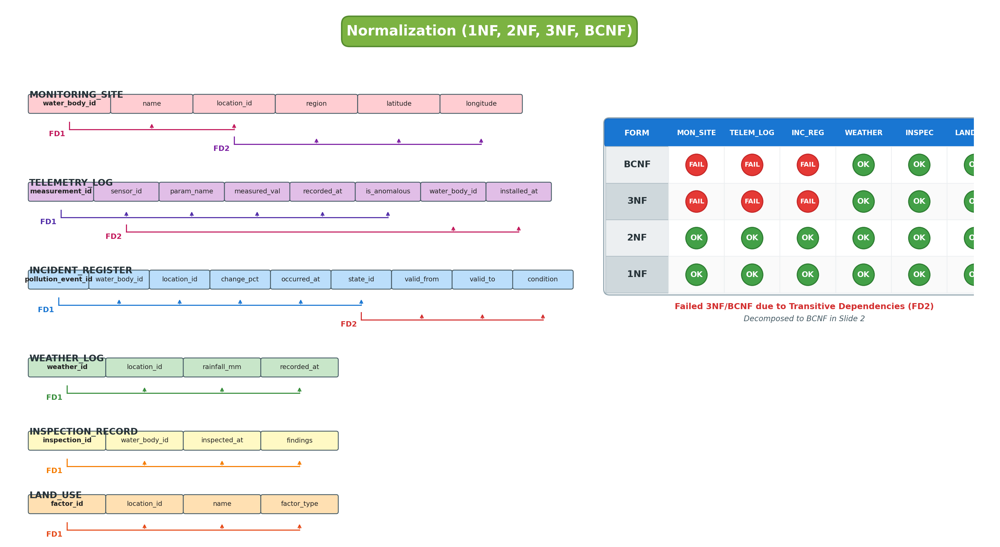
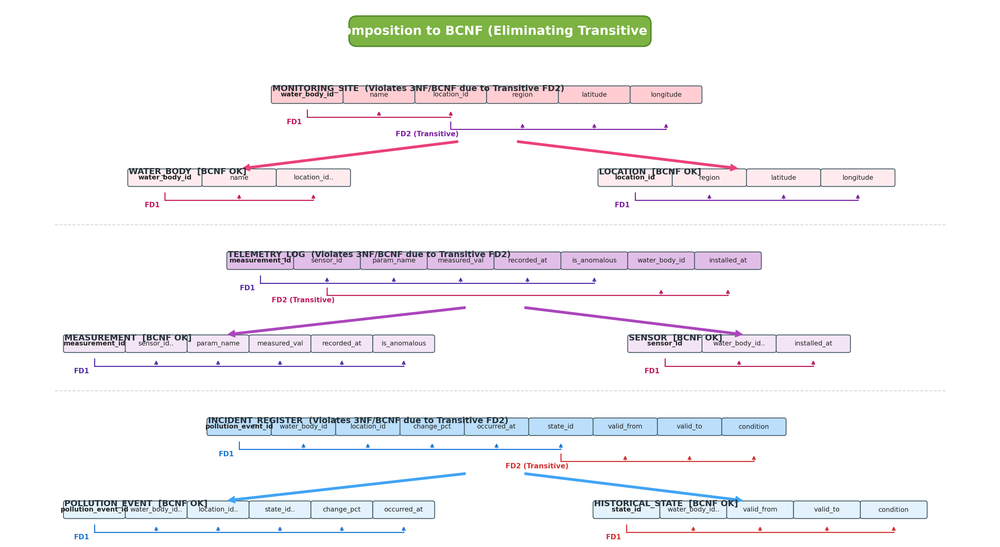

# Normalization (1NF, 2NF, 3NF, BCNF) — RVCE Senior Format

> **Format Reference:** RVCE Department of CSE — DBMS Lab (CD2521A)  
> Below are the high-resolution generated slide images matching the exact visual layout of your seniors' PDF.

## 🖼️ Visual Slide 1: Tables with FD Brackets & Compliance Matrix


## 🖼️ Visual Slide 2: Decomposition to BCNF (Branching Splits)


---

# PART 1: INITIAL SCHEMA & FUNCTIONAL DEPENDENCY ANALYSIS

Before decomposition, real-world monitoring databases often start with consolidated tables that mix entity attributes with transaction/event records:

---

### 1. `MONITORING_SITE` (Combined Water Body & Catchment Location)
Attributes: `water_body_id`, `name`, `location_id`, `region`, `latitude`, `longitude`

```
+---------------+-----------+---------------+-----------+------------+-------------+
| water_body_id |   name    |  location_id  |  region   |  latitude  |  longitude  |
+---------------+-----------+---------------+-----------+------------+-------------+
  |               ^           ^               ^           ^            ^
  |               |           |               |           |            |
  +-- FD1 --------+-----------+               |           |            |
                              |               |           |            |
                              +-- FD2 --------+-----------+------------+
```
- **FD1:** `water_body_id` $\rightarrow$ `name`, `location_id` *(Candidate Key: `water_body_id`)*
- **FD2:** `location_id` $\rightarrow$ `region`, `latitude`, `longitude`
- **Violation:** `location_id` is a **non-key attribute** determining other non-key attributes (`region`, `lat`, `long`). This is a **Transitive Dependency** ($\text{water\_body\_id} \rightarrow \text{location\_id} \rightarrow \text{region}$).
- **Status:** Satisfies 1NF, 2NF. **Violates 3NF and BCNF (❌)**.

---

### 2. `TELEMETRY_LOG` (Combined Sensor & Time-Series Measurement)
Attributes: `measurement_id`, `sensor_id`, `parameter_name`, `measured_value`, `recorded_at`, `is_anomalous`, `water_body_id`, `installed_at`

```
+----------------+-----------+----------------+----------------+-------------+--------------+---------------+--------------+
| measurement_id | sensor_id | parameter_name | measured_value | recorded_at | is_anomalous | water_body_id | installed_at |
+----------------+-----------+----------------+----------------+-------------+--------------+---------------+--------------+
  |                ^           ^                ^                ^             ^              ^               ^
  |                |           |                |                |             |              |               |
  +-- FD1 ---------+-----------+----------------+----------------+-------------+              |               |
                               |                                                              |               |
                               +-- FD2 (sensor_id) -------------------------------------------+---------------+
```
- **FD1:** `measurement_id` $\rightarrow$ `sensor_id`, `parameter_name`, `measured_value`, `recorded_at`, `is_anomalous` *(Candidate Key)*
- **FD2:** `sensor_id` $\rightarrow$ `water_body_id`, `installed_at`
- **Violation:** `sensor_id` is **not a candidate key** of `TELEMETRY_LOG`, yet it determines `water_body_id` and `installed_at`. Transitive dependency present.
- **Status:** Satisfies 1NF, 2NF. **Violates 3NF and BCNF (❌)**.

---

### 3. `INCIDENT_REGISTER` (Combined Pollution Event & Historical State)
Attributes: `pollution_event_id`, `water_body_id`, `location_id`, `change_percent`, `occurred_at`, `state_id`, `valid_from`, `valid_to`, `condition`

```
+--------------------+---------------+-------------+----------------+-------------+----------+------------+----------+-----------+
| pollution_event_id | water_body_id | location_id | change_percent | occurred_at | state_id | valid_from | valid_to | condition |
+--------------------+---------------+-------------+----------------+-------------+----------+------------+----------+-----------+
  |                    ^               ^             ^                ^             ^          ^            ^          ^
  |                    |               |             |                |             |          |            |          |
  +-- FD1 -------------+---------------+-------------+----------------+-------------+          |            |          |
                                                                                    |          |            |          |
                                                                                    +-- FD2 ---+------------+----------+
```
- **FD1:** `pollution_event_id` $\rightarrow$ `water_body_id`, `location_id`, `change_percent`, `occurred_at`, `state_id`
- **FD2:** `state_id` $\rightarrow$ `valid_from`, `valid_to`, `condition`
- **Violation:** `state_id` is a non-key determinant. Transitive dependency.
- **Status:** Satisfies 1NF, 2NF. **Violates 3NF and BCNF (❌)**.

---

### 4. `WEATHER_LOG`
Attributes: `weather_id`, `location_id`, `rainfall_mm`, `recorded_at`
- **FD1:** `weather_id` $\rightarrow$ `location_id`, `rainfall_mm`, `recorded_at`
- **Status:** All attributes depend solely on candidate key `weather_id`. **Satisfies 1NF, 2NF, 3NF, BCNF (✅)**.

---

### 5. `INSPECTION_RECORD`
Attributes: `inspection_id`, `water_body_id`, `inspected_at`, `findings`
- **FD1:** `inspection_id` $\rightarrow$ `water_body_id`, `inspected_at`, `findings`
- **Status:** All attributes depend solely on candidate key `inspection_id`. **Satisfies 1NF, 2NF, 3NF, BCNF (✅)**.

---

### 6. `LAND_USE`
Attributes: `factor_id`, `location_id`, `name`, `factor_type`
- **FD1:** `factor_id` $\rightarrow$ `location_id`, `name`, `factor_type`
- **Status:** All attributes depend solely on candidate key `factor_id`. **Satisfies 1NF, 2NF, 3NF, BCNF (✅)**.

---

# PART 2: INITIAL NORMALIZATION COMPLIANCE MATRIX

*(This is the exact grid from the top-right of your senior's slide)*

| Normal Form | `MONITORING_SITE` | `TELEMETRY_LOG` | `INCIDENT_REGISTER` | `WEATHER_LOG` | `INSPECTION_RECORD` | `LAND_USE` |
| :---: | :---: | :---: | :---: | :---: | :---: | :---: |
| **BCNF** | ❌ | ❌ | ❌ | ✅ | ✅ | ✅ |
| **3NF**  | ❌ | ❌ | ❌ | ✅ | ✅ | ✅ |
| **2NF**  | ✅ | ✅ | ✅ | ✅ | ✅ | ✅ |
| **1NF**  | ✅ | ✅ | ✅ | ✅ | ✅ | ✅ |

### Why Did They Fail 3NF / BCNF?
1. In `MONITORING_SITE`, $\text{location\_id} \rightarrow \text{region}, \text{lat}, \text{long}$, but $\text{location\_id}$ is not a super key.
2. In `TELEMETRY_LOG`, $\text{sensor\_id} \rightarrow \text{wb\_id}, \text{installed\_at}$, but $\text{sensor\_id}$ is not a super key.
3. In `INCIDENT_REGISTER`, $\text{state\_id} \rightarrow \text{valid\_from}, \text{valid\_to}, \text{condition}$, but $\text{state\_id}$ is not a super key.

---

# PART 3: DECOMPOSITION TO BCNF (The Senior's 2nd Slide)

To achieve **100% BCNF compliance**, we decompose each non-compliant table into two separate child relations based on their independent functional dependencies:

---

### Decomposition 1: `MONITORING_SITE` $\longrightarrow$ `WATER_BODY` + `LOCATION`

```
                                MONITORING_SITE
         +-------------------------------------------------------------+
         | water_body_id | name | location_id | region | lat | long    |
         +-------------------------------------------------------------+
               |                    |
               | FD1                | FD2
               v                    v
                       \          /
                        \        /
                         v      v
              [ Decompose into 2 Relations ]
                        /        \
                       /          \
                      v            v
           WATER_BODY                           LOCATION
+---------------+-----------+---------------+   +---------------+-----------+-----------+------------+
| water_body_id |   name    | location_id.. |   |  location_id  |  region   | latitude  | longitude  |
+---------------+-----------+---------------+   +---------------+-----------+-----------+------------+
  |                           ^                   |               ^           ^           ^
  +-- FD1 --------------------+                   +-- FD1 --------+-----------+-----------+
  Candidate Key: {water_body_id}                  Candidate Key: {location_id}
  Status: BCNF Satisfied (✅)                     Status: BCNF Satisfied (✅)
```

---

### Decomposition 2: `TELEMETRY_LOG` $\longrightarrow$ `MEASUREMENT` + `SENSOR`

```
                                TELEMETRY_LOG
  +---------------------------------------------------------------------------------+
  | measurement_id | sensor_id | param | value | time | flag | wb_id | installed_at |
  +---------------------------------------------------------------------------------+
          |                                            |
          | FD1                                        | FD2
          v                                            v
                         \                  /
                          \                /
                           v              v
                        [ Decompose into 2 Relations ]
                          /                \
                         /                  \
                        v                    v
             MEASUREMENT                                    SENSOR
+----------------+-----------+-------+-------+     +-----------+---------------+--------------+
| measurement_id | sensor_id.| param | value |     | sensor_id | water_body_id.| installed_at |
+----------------+-----------+-------+-------+     +-----------+---------------+--------------+
  |                ^                                 |           ^               ^
  +-- FD1 ---------+                                 +-- FD1 ----+---------------+
  Candidate Key: {measurement_id}                    Candidate Key: {sensor_id}
  Status: BCNF Satisfied (✅)                        Status: BCNF Satisfied (✅)
```

---

### Decomposition 3: `INCIDENT_REGISTER` $\longrightarrow$ `POLLUTION_EVENT` + `HISTORICAL_STATE`

```
                              INCIDENT_REGISTER
  +------------------------------------------------------------------------------------+
  | event_id | wb_id | loc_id | change_% | time | state_id | valid_from | valid_to | cond|
  +------------------------------------------------------------------------------------+
          |                                            |
          | FD1                                        | FD2
          v                                            v
                         \                  /
                          \                /
                           v              v
                        [ Decompose into 2 Relations ]
                          /                \
                         /                  \
                        v                    v
           POLLUTION_EVENT                              HISTORICAL_STATE
+----------+------------+------------+-------+     +----------+---------------+------------+-----------+
| event_id | wb_id..    | loc_id..   | state.|     | state_id | water_body_id.| valid_from | condition |
+----------+------------+------------+-------+     +----------+---------------+------------+-----------+
  |          ^            ^            ^             |          ^               ^            ^
  +-- FD1 ---+------------+------------+             +-- FD1 ---+---------------+------------+
  Candidate Key: {pollution_event_id}                Candidate Key: {state_id}
  Status: BCNF Satisfied (✅)                        Status: BCNF Satisfied (✅)
```

---

# PART 4: FINAL BCNF COMPLIANCE MATRIX (ALL 9 RELATIONS)

After decomposing all transitive dependencies, all 9 final relations strictly satisfy BCNF:

| Normal Form | `LOCATION` | `WATER_BODY` | `SENSOR` | `MEASUREMENT` | `WEATHER_REC` | `LAND_USE` | `HIST_STATE` | `POLL_EVENT` | `INSPECTION` |
| :---: | :---: | :---: | :---: | :---: | :---: | :---: | :---: | :---: | :---: |
| **BCNF** | ✅ | ✅ | ✅ | ✅ | ✅ | ✅ | ✅ | ✅ | ✅ |
| **3NF**  | ✅ | ✅ | ✅ | ✅ | ✅ | ✅ | ✅ | ✅ | ✅ |
| **2NF**  | ✅ | ✅ | ✅ | ✅ | ✅ | ✅ | ✅ | ✅ | ✅ |
| **1NF**  | ✅ | ✅ | ✅ | ✅ | ✅ | ✅ | ✅ | ✅ | ✅ |

### Formal BCNF Proof for Final Schema:
$$\forall \text{ relation } R_i \text{ and } \forall \text{ FD } X \rightarrow Y \text{ in } R_i, \quad X \text{ is a SUPER KEY of } R_i.$$
- Every single table in AquaTrace has a single-attribute candidate key (`location_id`, `water_body_id`, `sensor_id`, `measurement_id`, `weather_id`, `factor_id`, `state_id`, `pollution_event_id`, `inspection_id`).
- No non-key determinant exists in any relation.
- Lossless join decomposition and dependency preservation are strictly maintained.
