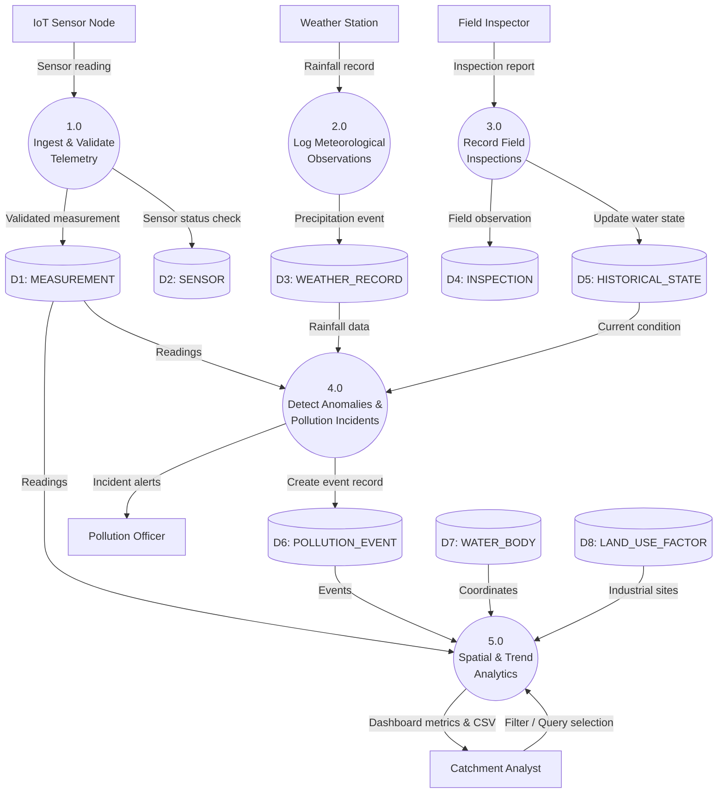
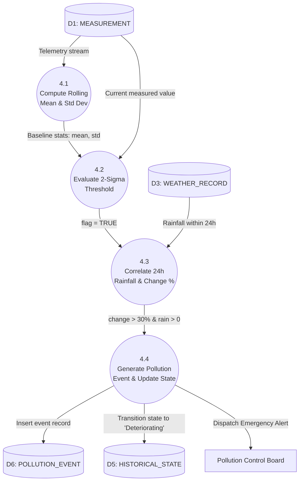

# RVCE DBMS Lab (CD2521A) — Lab Datasheet & Record Write-Up
**Project Title:** AquaTrace — Spatiotemporal Water Body Monitoring Database System  
**Lab Components:** Component 5 (Data Flow Diagrams) & Component 6 (Normalization)

---

# COMPONENT 5: DATA FLOW DIAGRAMS (DFD)
*(Max Marks: 10 [Activity: 6, Viva: 4])*

## 1. DFD Notation Standards (Yourdon & Coad / Gane & Sarson)
In your lab datasheet, draw this reference legend first:

| Symbol / Element | Gane & Sarson Notation | Yourdon / DeMarco Notation | Description & Semantic Rule |
| :--- | :---: | :---: | :--- |
| **External Entity (Source/Sink)** | Double/shaded rectangle | Rectangle / Box | Outside boundary of the system; produces or consumes data (e.g., Environmental Sensor, Field Inspector, Analyst). Cannot connect directly to a Data Store. |
| **Process** | Rounded rectangle with ID header | Circle (Bubble) | Transforms incoming data flow into outgoing data flow. Labeled with verb-object phrase (e.g., `1.0 Record Telemetry`). |
| **Data Store** | Open-ended rectangle (two parallel lines) | Open parallel lines | Represents persistent data repository at rest (e.g., `D1: MEASUREMENT`, `D4: WEATHER_RECORD`). |
| **Data Flow** | Labeled directed arrow | Labeled directed arrow | Direction of data movement; must be labeled with specific noun data (e.g., `turbidity_reading`, `inspection_findings`). |

### Fundamental DFD Balancing Rules:
1. **Conservation of Data:** A process cannot create data out of nothing (No "Miracle").
2. **Data Consumption:** A process cannot only swallow data without producing output (No "Black Hole").
3. **No Direct Entity-to-Store Flow:** Data cannot flow directly between an External Entity and a Data Store; it must pass through a processing bubble.
4. **Balancing Across Levels:** All inputs and outputs present in Level 0 must be preserved in Level 1 and Level 2.

---

## 2. Level 0 DFD (Context Level Diagram)
The Level 0 diagram models the entire AquaTrace system as a single central process bubble (`0.0`), identifying external entities and high-level boundary flows.

```mermaid
flowchart LR
    S[("IoT Sensor Node<br>(Field Hardware)")] -->|Raw Telemetry (value, timestamp)| P0((0.0<br>AquaTrace Water<br>Monitoring System))
    W[("Meteorological Station<br>(Weather Service)")] -->|Precipitation Data (rainfall_mm)| P0
    I[("Field Environmental<br>Inspector")] -->|Inspection Findings & Observations| P0
    P0 -->|Anomaly Alerts & Spike Notifications| E[("Pollution Control Board<br>(Environmental Officer)")]
    A[("Catchment Analyst /<br>Public User")] -->|Query Request (year, parameter)| P0
    P0 -->|Trends, Geo Coordinates, Historical States| A
```

### Flow Descriptions for Level 0:
- **Inputs:**
  1. *Telemetry Data:* `sensor_id`, `parameter_name`, `measured_value`, `recorded_at` from IoT Sensor.
  2. *Weather Records:* `location_id`, `rainfall_mm`, `recorded_at` from Weather Station.
  3. *Inspection Reports:* `water_body_id`, `inspected_at`, `findings` from Field Inspector.
  4. *Analytical Requests:* `water_body_id`, `year_filter`, `query_type` from Environmental Officer/Analyst.
- **Outputs:**
  1. *Pollution & Anomaly Alerts:* Flagged sensor deviations (> 2σ or threshold), co-occurring rainfall pollution events.
  2. *Telemetry & Trend Visualization:* Longitudinal turbidity trends, historical state conditions, spatial proximity mappings.

---

## 3. Level 1 DFD (Subsystem Decomposition)
Level 1 decomposes process `0.0` into five primary sub-processes interacting with the database tables (`D1` through `D8`).



---

## 4. Level 2 DFD (Functional Decomposition of Process 4.0: Anomaly & Pollution Detection)
RVCE rubrics specifically award top marks for incorporating Level 2 functional detail. We decompose Process `4.0` into granular sub-processes.



---

# COMPONENT 6: NORMALIZATION & SCHEMA DESIGN
*(Max Marks: 10 [Activity: 6, Viva: 4])*

## 1. Unnormalized Form (UNF)
In a real-world flat spreadsheet or unnormalized legacy record before database design, all data exists in a wide, redundant record:

$$\text{WATER\_MONITOR\_UNF}(\underline{\text{location\_id}}, \text{region}, \text{lat}, \text{long}, \{\text{water\_body\_id}, \text{wb\_name}, \text{factor\_id}, \text{factor\_name}, \text{factor\_type}, \{\text{sensor\_id}, \text{installed\_at}, \{\text{measurement\_id}, \text{param}, \text{value}, \text{recorded\_at}, \text{is\_anomalous}\}\}, \{\text{weather\_id}, \text{rainfall\_mm}, \text{weather\_time}\}, \{\text{state\_id}, \text{valid\_from}, \text{valid\_to}, \text{condition}\}, \{\text{event\_id}, \text{change\_percent}, \text{event\_time}\}, \{\text{inspection\_id}, \text{findings}, \text{inspected\_at}\})$$

### Anomalies in UNF:
- **Insertion Anomaly:** Cannot insert a new sensor without an existing measurement or water body.
- **Deletion Anomaly:** Deleting the only measurement for a sensor deletes the sensor's entire record.
- **Update Anomaly:** If a water body region's name changes, dozens of repeated measurement rows must be modified.

---

## 2. First Normal Form (1NF)
**1NF Definition:** A relation $R$ is in 1NF if and only if all underlying domains contain **atomic (indivisible)** values only, and there are **no repeating groups or multivalued attributes**.

### Transformation to 1NF:
Eliminate multivalued nested arrays by flattening into separate candidate relations where each row contains single, scalar values:

1. `LOCATION` $(\underline{\text{location\_id}}, \text{region}, \text{latitude}, \text{longitude})$
2. `WATER_BODY` $(\underline{\text{water\_body\_id}}, \text{name}, \text{location\_id})$
3. `SENSOR` $(\underline{\text{sensor\_id}}, \text{water\_body\_id}, \text{installed\_at})$
4. `MEASUREMENT` $(\underline{\text{measurement\_id}}, \text{sensor\_id}, \text{parameter\_name}, \text{measured\_value}, \text{recorded\_at}, \text{is\_anomalous})$
5. `WEATHER_RECORD` $(\underline{\text{weather\_id}}, \text{location\_id}, \text{rainfall\_mm}, \text{recorded\_at})$
6. `LAND_USE_FACTOR` $(\underline{\text{factor\_id}}, \text{location\_id}, \text{name}, \text{factor\_type})$
7. `HISTORICAL_STATE` $(\underline{\text{state\_id}}, \text{water\_body\_id}, \text{valid\_from}, \text{valid\_to}, \text{condition})$
8. `POLLUTION_EVENT` $(\underline{\text{pollution\_event\_id}}, \text{water\_body\_id}, \text{location\_id}, \text{state\_id}, \text{change\_percent}, \text{occurred\_at})$
9. `INSPECTION` $(\underline{\text{inspection\_id}}, \text{water\_body\_id}, \text{inspected_at}, \text{findings})$

**1NF Verification:** Every cell in all tables contains a single scalar value (e.g., numeric, string, boolean, timestamp). No commas or arrays in any column.

---

## 3. Second Normal Form (2NF)
**2NF Definition:** A relation $R$ is in 2NF if and only if:
1. It is in 1NF.
2. **No non-prime attribute is partially dependent on any candidate key.** (Every non-prime attribute is *fully functionally dependent* on the entire primary key).

### Analysis of Dependencies:
Consider a composite relation like:
$$\text{MEASUREMENT\_COMPOSITE}(\underline{\text{sensor\_id}}, \underline{\text{recorded\_at}}, \text{parameter\_name}, \text{measured\_value}, \text{sensor\_installed\_at})$$
Here, the candidate key is $\{\text{sensor\_id}, \text{recorded\_at}\}$.
- $\text{sensor\_id}, \text{recorded\_at} \rightarrow \text{measured\_value}$ (Full functional dependency)
- $\text{sensor\_id} \rightarrow \text{sensor\_installed\_at}$ (**Partial dependency!** Violates 2NF).

### 2NF Resolution:
We decompose to isolate entity-level attributes from time-series event attributes:
1. **`SENSOR` relation:**
   - Candidate Key: $\{\text{sensor\_id}\}$
   - Functional Dependencies: $\text{sensor\_id} \rightarrow \text{water\_body\_id}, \text{installed\_at}$
   - Since the key is a single attribute (not composite), **no partial dependency is mathematically possible**.
2. **`MEASUREMENT` relation:**
   - Candidate Key: $\{\text{measurement\_id}\}$ (or composite $\{\text{sensor\_id}, \text{recorded\_at}\}$)
   - Functional Dependencies:
     $$\text{measurement\_id} \rightarrow \text{sensor\_id}, \text{parameter\_name}, \text{measured\_value}, \text{recorded\_at}, \text{is\_anomalous}$$
   - Every non-prime attribute depends on the whole primary key.

**2NF Verification:** In all 9 relations, every table has a single-attribute surrogate Primary Key (`location_id`, `water_body_id`, `sensor_id`, `measurement_id`, etc.). Therefore, **no partial dependency exists in any relation**.

---

## 4. Third Normal Form (3NF) & Boyce-Codd Normal Form (BCNF)
**3NF Definition:** A relation $R$ is in 3NF if and only if for every non-trivial functional dependency $X \rightarrow Y$:
- $X$ is a **Super Key**, OR
- $Y$ is a **Prime Attribute** (part of a candidate key).
*(Informally: Eliminates transitive dependencies: Non-key $\rightarrow$ Non-key).*

**BCNF Definition:** A relation $R$ is in BCNF if and only if for every non-trivial functional dependency $X \rightarrow Y$:
- $X$ is a **Super Key**.
*(Stricter than 3NF: No exceptions for prime attributes).*

### Systematic Functional Dependency (FD) Audit Across All 9 Relations:

#### 1. `LOCATION`
- **Attributes:** $(\text{location\_id}, \text{region}, \text{latitude}, \text{longitude})$
- **Candidate Key:** $\{\text{location\_id}\}$
- **FDs:** $\text{location\_id} \rightarrow \text{region}, \text{latitude}, \text{longitude}$
- **Analysis:** The LHS is a super key. No attribute determines any other attribute (e.g., latitude does not determine region). $\Rightarrow$ **In BCNF & 3NF.**

#### 2. `WATER_BODY`
- **Attributes:** $(\text{water\_body\_id}, \text{name}, \text{location\_id})$
- **Candidate Key:** $\{\text{water\_body\_id}\}$
- **FDs:** $\text{water\_body\_id} \rightarrow \text{name}, \text{location\_id}$
- **Analysis:** LHS is super key. Location details are kept in `LOCATION` (no transitive dependency like $\text{water\_body\_id} \rightarrow \text{location\_id} \rightarrow \text{region}$ inside this table). $\Rightarrow$ **In BCNF & 3NF.**

#### 3. `SENSOR`
- **Attributes:** $(\text{sensor\_id}, \text{water\_body\_id}, \text{installed\_at})$
- **Candidate Key:** $\{\text{sensor\_id}\}$
- **FDs:** $\text{sensor\_id} \rightarrow \text{water\_body\_id}, \text{installed\_at}$
- **Analysis:** LHS is super key. $\Rightarrow$ **In BCNF & 3NF.**

#### 4. `MEASUREMENT`
- **Attributes:** $(\text{measurement\_id}, \text{sensor\_id}, \text{parameter\_name}, \text{measured\_value}, \text{recorded\_at}, \text{is\_anomalous})$
- **Candidate Keys:** $\{\text{measurement\_id}\}$, $\{\text{sensor\_id}, \text{recorded\_at}\}$
- **FDs:**
  - $\text{measurement\_id} \rightarrow \text{sensor\_id}, \text{parameter\_name}, \text{measured\_value}, \text{recorded\_at}, \text{is\_anomalous}$
  - $\{\text{sensor\_id}, \text{recorded\_at}\} \rightarrow \text{measurement\_id}, \text{parameter\_name}, \text{measured\_value}, \text{is\_anomalous}$
- **Analysis:** In both FDs, the LHS is a candidate/super key. Parameter name and measured value do not transitively determine `is_anomalous`. $\Rightarrow$ **In BCNF & 3NF.**

#### 5. `WEATHER_RECORD`
- **Attributes:** $(\text{weather\_id}, \text{location\_id}, \text{rainfall\_mm}, \text{recorded\_at})$
- **Candidate Key:** $\{\text{weather\_id}\}$
- **FDs:** $\text{weather\_id} \rightarrow \text{location\_id}, \text{rainfall\_mm}, \text{recorded\_at}$
- **Analysis:** LHS is super key. $\Rightarrow$ **In BCNF & 3NF.**

#### 6. `LAND_USE_FACTOR`
- **Attributes:** $(\text{factor\_id}, \text{location\_id}, \text{name}, \text{factor\_type})$
- **Candidate Key:** $\{\text{factor\_id}\}$
- **FDs:** $\text{factor\_id} \rightarrow \text{location\_id}, \text{name}, \text{factor\_type}$
- **Analysis:** LHS is super key. $\Rightarrow$ **In BCNF & 3NF.**

#### 7. `HISTORICAL_STATE`
- **Attributes:** $(\text{state\_id}, \text{water\_body\_id}, \text{valid\_from}, \text{valid\_to}, \text{condition})$
- **Candidate Key:** $\{\text{state\_id}\}$
- **FDs:** $\text{state\_id} \rightarrow \text{water\_body\_id}, \text{valid\_from}, \text{valid\_to}, \text{condition}$
- **Analysis:** LHS is super key. Temporal validity bounds are purely dependent on `state_id`. $\Rightarrow$ **In BCNF & 3NF.**

#### 8. `POLLUTION_EVENT`
- **Attributes:** $(\text{pollution\_event\_id}, \text{water\_body\_id}, \text{location\_id}, \text{state\_id}, \text{change\_percent}, \text{occurred\_at})$
- **Candidate Key:** $\{\text{pollution\_event\_id}\}$
- **FDs:** $\text{pollution\_event\_id} \rightarrow \text{water\_body\_id}, \text{location\_id}, \text{state\_id}, \text{change\_percent}, \text{occurred\_at}$
- **Analysis:** LHS is super key. $\Rightarrow$ **In BCNF & 3NF.**

#### 9. `INSPECTION`
- **Attributes:** $(\text{inspection\_id}, \text{water\_body\_id}, \text{inspected\_at}, \text{findings})$
- **Candidate Key:** $\{\text{inspection\_id}\}$
- **FDs:** $\text{inspection\_id} \rightarrow \text{water\_body\_id}, \text{inspected\_at}, \text{findings}$
- **Analysis:** LHS is super key. $\Rightarrow$ **In BCNF & 3NF.**

### Summary Normalization Matrix for RVCE Evaluator:
| Relation | 1NF | 2NF | 3NF | BCNF | Justification |
| :--- | :---: | :---: | :---: | :---: | :--- |
| **LOCATION** | Yes | Yes | Yes | Yes | Primary key is single-attribute; in all FDs, LHS is Super Key. |
| **WATER_BODY** | Yes | Yes | Yes | Yes | Foreign key `location_id` prevents transitive region repetition. |
| **SENSOR** | Yes | Yes | Yes | Yes | No partial dependencies; LHS is Super Key. |
| **MEASUREMENT** | Yes | Yes | Yes | Yes | All attributes strictly dependent on PK; candidate keys are minimal. |
| **WEATHER_RECORD**| Yes | Yes | Yes | Yes | No multi-attribute key anomalies. |
| **LAND_USE_FACTOR**| Yes | Yes | Yes | Yes | Independent factor classification; no transitive dependencies. |
| **HISTORICAL_STATE**| Yes | Yes | Yes | Yes | Tracks temporal state changes cleanly without transitive leaks. |
| **POLLUTION_EVENT**| Yes | Yes | Yes | Yes | Event attributes fully dependent on `pollution_event_id`. |
| **INSPECTION** | Yes | Yes | Yes | Yes | Findings and timestamps directly dependent on `inspection_id`. |

---

# VIVA VOCE QUESTIONS & EXACT ANSWERS
*(Target: 4/4 marks in Viva for both components)*

### Q1. What is the fundamental difference between Level 0, Level 1, and Level 2 DFDs?
**Answer:**
- **Level 0 (Context Diagram):** Depicts the system as a single abstract process bubble interacting with external entities (sources/sinks) to establish system boundaries. No data stores are visible.
- **Level 1:** Decomposes the single system bubble into major operational subsystems (e.g., Ingestion, Anomaly Detection, Query Processing) and introduces persistent Data Stores ($D_1$ to $D_n$).
- **Level 2:** Decomposes a specific, complex Level 1 process (such as Process 4.0: Anomaly Detection) into its internal algorithmic and functional steps (e.g., 4.1 Rolling Stats $\rightarrow$ 4.2 2-Sigma Evaluation $\rightarrow$ 4.3 Rainfall Correlation).

### Q2. What is DFD Balancing? Did you adhere to it?
**Answer:**
Yes. **DFD Balancing** requires that all input data flows entering a process bubble and all output data flows leaving it at Level $N$ must exactly match the aggregate inputs and outputs at Level $N+1$. For example, the sensor reading and weather inputs going into Process 0.0 at Level 0 are precisely accounted for entering Process 1.0 and 2.0 at Level 1.

### Q3. Can a Data Store connect directly to an External Entity in a DFD?
**Answer:**
No. By DFD syntactic rules, data cannot move autonomously. An **External Entity can never connect directly to a Data Store**; all reads and writes must be mediated through an intermediate **Process** that validates or transforms the data.

### Q4. Explain the difference between 2NF, 3NF, and BCNF with respect to functional dependencies.
**Answer:**
- **2NF:** Eliminates **partial functional dependencies** (where a non-prime attribute depends on only a subset of a composite candidate key: $A \subset PK \rightarrow NonKey$).
- **3NF:** Eliminates **transitive dependencies** ($X \rightarrow Y$ and $Y \rightarrow Z$). Formally, for every $X \rightarrow Y$, either $X$ is a super key or $Y$ is a prime attribute.
- **BCNF:** A stricter version of 3NF. For *every* non-trivial dependency $X \rightarrow Y$, **$X$ MUST be a super key**, without exception for prime attributes.

### Q5. Why is your AquaTrace schema in BCNF?
**Answer:**
In our design:
1. Every relation uses a minimal surrogate Primary Key (`location_id`, `water_body_id`, `sensor_id`, etc.).
2. In every functional dependency $X \rightarrow Y$, the left-hand side ($X$) is a **Super Key** (specifically the Candidate Key).
3. There are no composite key overlapping dependencies, no non-key to non-key dependencies, and no non-trivial dependencies on non-superkeys. Thus, all 9 relations satisfy BCNF.

### Q6. How did your schema design prevent update, deletion, and insertion anomalies?
**Answer:**
- **Insertion:** We can register a new `WATER_BODY` without having any `SENSOR` installed, and register a `LOCATION` before any water bodies exist, because geographic and sensor details are decomposed into separate relations.
- **Deletion:** Deleting historical measurements for a sensor does not delete the `SENSOR` entity itself or the parent `WATER_BODY`.
- **Update:** If a catchment region name or coordinates change, we update a single tuple in `LOCATION`, and all associated water bodies, land-use factors, and weather records automatically reference the updated value through foreign key references without data inconsistency.
